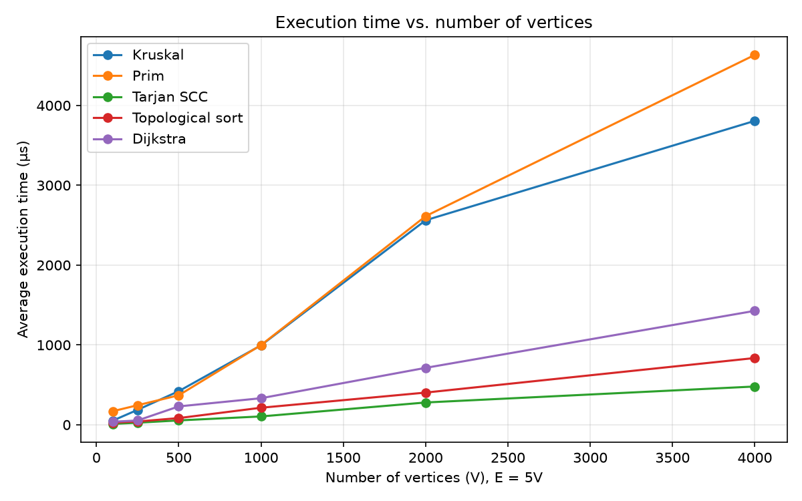
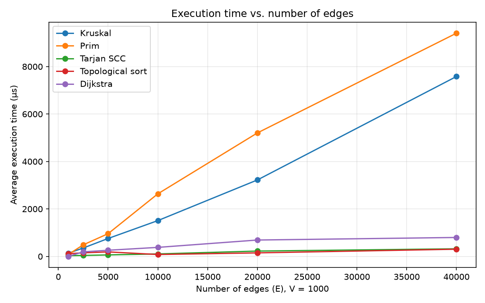
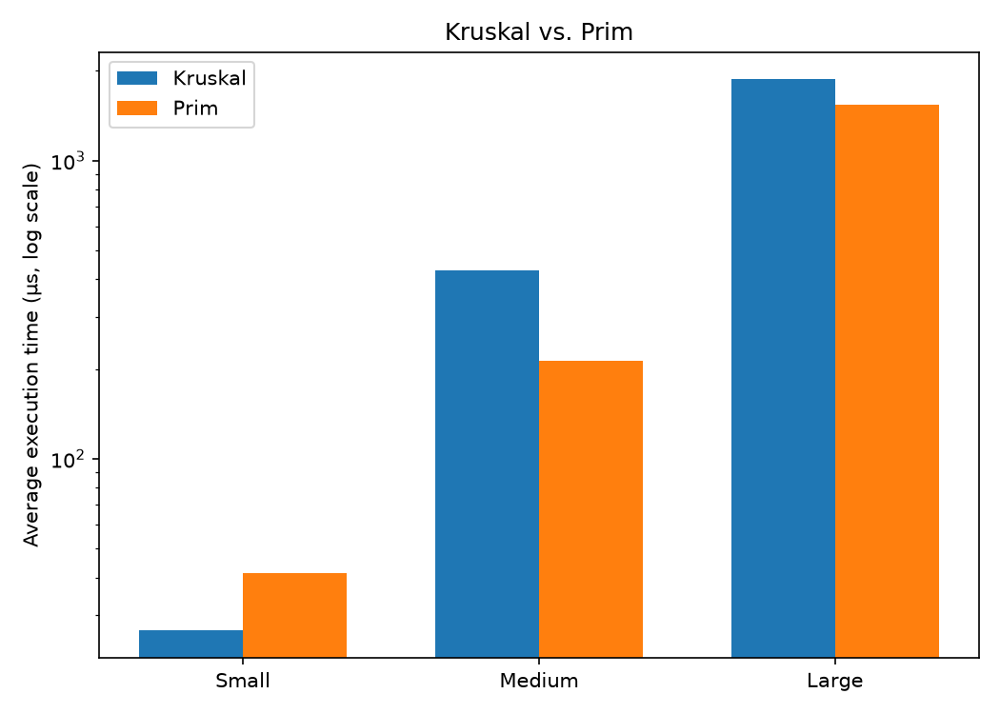

# Assignment 3: Smart City Infrastructure and Route Planning

In this project I model a city as a graph and solve three planning problems on it: connecting all districts
with the cheapest network (minimum spanning tree), checking how the network is connected (topological order and
strongly connected components), and finding the shortest routes from one district (Dijkstra). Everything is
written in Java. This README is the full report: how the code works, the complexity of each algorithm, the
experiments, the results and the tests.

## Contents
1. [Overview](#1-overview)
2. [Implementation](#2-implementation)
3. [Complexity Analysis](#3-complexity-analysis)
4. [Experimental Setup](#4-experimental-setup)
5. [Results](#5-results)
6. [Comparison and Discussion](#6-comparison-and-discussion)
7. [Testing](#7-testing)
8. [Conclusion](#8-conclusion)
9. [How to run](#9-how-to-run)

---

## 1. Overview

Vertices are city districts (numbered 0 to V-1) and edges are roads or infrastructure links. The weight of an
edge is either a construction cost (for the MST part) or a distance (for the shortest path part). In all
generated graphs the weights are integers from 1 to 100.

The graph is stored as an adjacency list. The class `graph.Graph` keeps a list of outgoing edges for every
vertex and also one flat list with all edges. The adjacency lists are used by Prim, Tarjan, topological sort and
Dijkstra. The flat list is used by Kruskal, because it has to sort all edges. For an undirected graph, `addEdge`
puts the edge once in the flat list and twice in the adjacency lists (one for each direction), so the adjacency
lists hold 2E entries. For a directed graph they hold E entries. Memory is O(V + E).

Project structure:

```
daa-assignment3/
├── src/
│   ├── graph/          Edge, Graph, GraphGenerator
│   ├── dsu/            DSU
│   ├── mst/            Kruskal, Prim, MSTResult
│   ├── connectivity/   TarjanSCC, TopologicalSort, SCCResult, TopoResult
│   ├── shortestpath/   Dijkstra, DijkstraResult
│   ├── tests/          Tests (59 checks)
│   ├── Main.java       small Dijkstra demo
│   └── Benchmark.java  runs all experiments and writes results/tables/*.csv
├── results/
│   ├── tables/         CSV files written by Benchmark
│   └── plots/          PNG files written by plot_results.py
├── plot_results.py
└── README.md
```

---

## 2. Implementation

**DSU.** It is an array based disjoint set with `parent[]` and `rank[]`. `find` is iterative, so deep trees can
not cause a stack overflow. Path compression and union by rank can each be switched on or off, which lets me
measure what each of them does. The class counts `findCalls`, `unionCalls` and `parentSteps` (how many parent
pointers `find` follows in total). `union` returns false if both elements are already in the same set, and
Kruskal uses that as its cycle check. The DSU also keeps the number of components, so Kruskal can tell whether
the graph was connected.

**Kruskal.** It copies the edge list, sorts it by weight and goes through the edges in order. An edge is taken
when `union` succeeds. It stops after V-1 edges have been taken. If the DSU does not end with exactly one
component the graph is reported as not connected (and the result is a spanning forest). The comparator counts
its calls, so I get the number of sorting comparisons.

**Prim.** I used the lazy version with Java's `PriorityQueue`. From a start vertex it pushes all edges that go
to unvisited vertices, then repeatedly takes the cheapest edge from the heap. If the other end is already
visited the edge is skipped, otherwise it joins the tree. The outer loop starts again from every vertex that is
still unvisited, so disconnected graphs give a spanning forest and `connected = false`.

**Topological ordering.** Kahn's algorithm: count in-degrees, put the vertices with in-degree 0 in a queue, and
remove them one by one. If fewer than V vertices come out, the graph has a cycle. In that case `isDAG` is false
and the order is returned empty. `isValidOrder` checks that every edge goes forward in an order; the tests and
the benchmark use it.

**Strongly connected components.** Tarjan's algorithm with `disc` and `low` arrays and a stack. The result has
the list of components and a `componentId` array. The DFS is recursive, so a graph with a very long path
(tens of thousands of vertices) would need a bigger JVM stack. My experiments go up to 4000 vertices, so this
never happened.

**Dijkstra.** It uses a binary heap with lazy deletion: instead of decrease-key I push a new entry every time
a distance improves and skip outdated entries when they come out. Unreachable vertices get `INF`
(`Long.MAX_VALUE`) and `getPath` rebuilds paths from the parent array. Negative weights are rejected at the
start with an `IllegalArgumentException`.

**Why Dijkstra fails with negative weights.** Dijkstra treats the distance of a vertex as final when the vertex
leaves the heap. That is only safe if every other path to it must be at least as long, which holds when all
weights are non-negative. With a negative edge it breaks. Example: `0→1` (2), `0→2` (3), `2→1` (-2).
Dijkstra takes vertex 1 first with distance 2 and never looks at it again, but the real shortest path is
`0→2→1` with length 1. For negative weights (without negative cycles) Bellman-Ford with O(V·E) time is the
usual choice. I only use it in the tests, as a reference to check Dijkstra against.

**Counters.** Besides time, every algorithm counts basic operations:

| Algorithm | Counters |
|---|---|
| Kruskal | edges examined, comparisons (sorting), DSU finds, DSU unions |
| Prim | edges examined, comparisons (heap), heap pushes, heap polls |
| Tarjan | vertices visited, edges examined |
| Topological sort | vertices processed, edges examined |
| Dijkstra | edges examined, relaxations, comparisons, heap pushes, heap polls |

These counters are not directly comparable between algorithms. For example Prim's "edges examined" is about 2E
because each undirected edge is in two adjacency lists, while Kruskal's is at most E. Kruskal's comparisons come
from sorting and Prim's come from the heap.

---

## 3. Complexity Analysis

Assumptions: adjacency list, V vertices, E edges, binary heap (`PriorityQueue`) for Prim and Dijkstra, and a
comparison sort for Kruskal. Since E is at most V², log E is O(log V).

| Algorithm | Time | Extra space | How V and E affect it |
|---|---|---|---|
| DSU find/union, with both optimisations | O(α(n)) amortised per operation | O(n) | α is the inverse Ackermann function, at most 4 in practice, so almost constant |
| DSU, union by rank only | O(log n) per operation | O(n) | tree height is at most log n |
| DSU, path compression only | O(log n) amortised | O(n) | every find flattens the path it walks |
| DSU, no optimisation | O(n) per operation in the worst case | O(n) | trees can become chains |
| Kruskal | O(E log E) = O(E log V) | O(V + E) | sorting dominates, the DSU part is O(E·α(V)); grows almost linearly with E |
| Prim (lazy heap) | O(E log E) = O(E log V) | O(V + E) | every edge is pushed and polled at most once; the heap can hold up to E entries |
| Tarjan SCC | O(V + E) | O(V) | every vertex and edge is visited once |
| Topological sort (Kahn) | O(V + E) | O(V) | one pass over all edges for in-degrees, one pass for processing |
| Dijkstra (binary heap) | O((V + E) log V) | O(V + E) | heap work depends on the number of relaxations; heap size at most E + 1 |

Some notes:
- Kruskal and Prim have the same bound here. With an indexed heap Prim is also O(E log V), and with a
  Fibonacci heap it is O(E + V log V), which would be better for dense graphs. The lazy version I use can hold
  up to E entries in the heap, so its cost depends on E.
- For very dense graphs (E close to V²) a simple array based Prim in O(V²) would beat both versions.
- In Dijkstra, lazy deletion allows duplicate heap entries, so the heap has at most E + 1 entries. Since
  log(E+1) is O(log V), the bound stays O((V + E) log V).

---

## 4. Experimental Setup

I ran everything on my own laptop (Windows, IntelliJ IDEA, Temurin JDK 25.0.2).

Graph sizes required by the assignment:

| Name | V | E |
|---|---|---|
| Small | 10 | 30 |
| Medium | 100 | 500 |
| Large | 1000 | 5000 |

**Graph generation** (`graph.GraphGenerator`). All graphs use `java.util.Random` with the fixed seed 42 + V, so
they are the same on every run. Weights are random integers from 1 to 100, and there are no self-loops and no
duplicate edges.
- Connected undirected graphs (for Kruskal and Prim): first a random spanning tree (vertices are shuffled and
  each vertex is connected to a random earlier one), then random extra edges until there are E edges. This
  makes sure the graph is connected.
- Directed graphs with cycles (for SCC, Dijkstra, and the cyclic case of topological sort): E random distinct
  ordered pairs (u, v). These graphs are not acyclic. Kahn's algorithm fails on all three sizes (see results),
  and at Large size the graph has 21 strongly connected components, one of them with 980 vertices.
- Directed acyclic graphs: a random permutation of the vertices gives a hidden order, and edges only go from
  earlier to later vertices in that order, so no cycle is possible.

**Measuring.** Time is measured with `System.nanoTime()` inside each algorithm, so graph generation is not
included. For Kruskal the time includes copying and sorting the edges and creating the DSU. Each algorithm runs
50 times as warm-up (so the JIT compiler is done), then 5 timed runs, and the tables show the average of those
5 runs in microseconds. The DSU stress test uses 3 warm-up runs because the version without optimisations is
very slow. My first benchmark run had only 3 warm-up runs and the numbers were inconsistent (the same graph took
428 µs in one table and 52 µs in another), so I increased the warm-up and re-ran everything. Operation counts
do not change between runs. Dijkstra always starts at vertex 0.

**Experiments**
1. Kruskal against Prim on Small, Medium and Large (`mst.csv`).
2. The DSU optimisations, once inside Kruskal (`dsu_kruskal.csv`) and once alone in a stress test
   (`dsu_micro.csv`): 10,000 elements, first 9,999 unions built as `union(i+1, i)`, which is the worst case for a
   DSU without optimisations, then 50,000 random unions.
3. Tarjan SCC (`scc.csv`), topological sort on a DAG and on a cyclic graph (`topo.csv`) and Dijkstra
   (`dijkstra.csv`).
4. Two sweeps for the plots (`scaling.csv`): V from 100 to 4000 with E = 5V, and E from 1000 to 40000 with
   V = 1000.

---

## 5. Results

All tables come from `Benchmark.java` and are saved in `results/tables/`.

### 5.1 Kruskal vs. Prim (`mst.csv`)

| Graph | V | E | Algorithm | Time (µs) | MST weight | Connected | Edges examined | Comparisons | DSU finds | DSU unions | Heap pushes | Heap polls |
|---|---|---|---|---|---|---|---|---|---|---|---|---|
| Small | 10 | 30 | Kruskal | 14.24 | 177 | yes | 15 | 107 | 30 | 15 | - | - |
| Small | 10 | 30 | Prim | 19.96 | 177 | yes | 60 | 196 | - | - | 30 | 30 |
| Medium | 100 | 500 | Kruskal | 108.34 | 1182 | yes | 367 | 3,845 | 734 | 367 | - | - |
| Medium | 100 | 500 | Prim | 139.58 | 1182 | yes | 1,000 | 7,609 | - | - | 500 | 500 |
| Large | 1000 | 5000 | Kruskal | 794.84 | 11984 | yes | 3,378 | 50,323 | 6,756 | 3,378 | - | - |
| Large | 1000 | 5000 | Prim | 695.54 | 11984 | yes | 10,000 | 111,453 | - | - | 5,000 | 5,000 |

Both algorithms find the same total weight on every graph (177, 1182 and 11984).

### 5.2 DSU optimisations

Inside Kruskal (`dsu_kruskal.csv`, time in µs). The numbers of find and union calls are the same in all four
variants (30/15, 734/367 and 6756/3378).

| Graph | none | path compression only | union by rank only | both |
|---|---|---|---|---|
| Small (10, 30) | 5.58 | 6.72 | 4.20 | 5.54 |
| Medium (100, 500) | 173.64 | 84.00 | 103.42 | 81.66 |
| Large (1000, 5000) | 1582.62 | 777.30 | 795.56 | 860.34 |

Stress test of the DSU alone (`dsu_micro.csv`, n = 10,000, 59,999 union calls, so 119,998 find calls in every
variant):

| Path compression | Union by rank | Time (µs) | find calls | Parent steps |
|---|---|---|---|---|
| no | no | 847,516.98 | 119,998 | 499,092,939 |
| yes | no | 1,096.92 | 119,998 | 109,986 |
| no | yes | 1,024.88 | 119,998 | 109,984 |
| yes | yes | 1,070.08 | 119,998 | 109,984 |

### 5.3 Strongly connected components (`scc.csv`)

| Graph | V | E | Time (µs) | SCCs | Largest SCC | Vertices visited | Edges examined |
|---|---|---|---|---|---|---|---|
| Small | 10 | 30 | 11.12 | 1 | 10 | 10 | 30 |
| Medium | 100 | 500 | 20.90 | 1 | 100 | 100 | 500 |
| Large | 1000 | 5000 | 159.48 | 21 | 980 | 1000 | 5000 |

### 5.4 Topological ordering (`topo.csv`)

| Graph | V | E | Input | Time (µs) | Is DAG | Order length | Vertices processed | Edges examined |
|---|---|---|---|---|---|---|---|---|
| Small | 10 | 30 | DAG | 8.76 | yes | 10 | 10 | 60 |
| Small | 10 | 30 | cyclic | 2.92 | no | 0 | 0 | 30 |
| Medium | 100 | 500 | DAG | 14.20 | yes | 100 | 100 | 1,000 |
| Medium | 100 | 500 | cyclic | 6.38 | no | 0 | 0 | 500 |
| Large | 1000 | 5000 | DAG | 151.52 | yes | 1000 | 1000 | 10,000 |
| Large | 1000 | 5000 | cyclic | 58.66 | no | 0 | 11 | 5,054 |

The order of every DAG was checked with `isValidOrder` and was valid. For cyclic graphs the order is empty on
purpose, so there is nothing to validate.

### 5.5 Dijkstra (`dijkstra.csv`, source 0, directed random graphs)

| Graph | V | E | Time (µs) | Reachable | Edges examined | Relaxations | Comparisons | Heap pushes | Heap polls |
|---|---|---|---|---|---|---|---|---|---|
| Small | 10 | 30 | 9.74 | 10 | 30 | 12 | 33 | 13 | 13 |
| Medium | 100 | 500 | 86.28 | 100 | 500 | 150 | 1,593 | 151 | 151 |
| Large | 1000 | 5000 | 250.52 | 989 | 4,946 | 1,424 | 23,857 | 1,425 | 1,425 |

### 5.6 Scaling sweeps (`scaling.csv`, time in µs)

Varying V with E = 5V:

| V | E | Kruskal | Prim | Tarjan SCC | Topological sort | Dijkstra |
|---|---|---|---|---|---|---|
| 100 | 500 | 51.78 | 23.10 | 4.82 | 11.80 | 10.84 |
| 250 | 1,250 | 145.38 | 120.02 | 28.20 | 31.46 | 77.42 |
| 500 | 2,500 | 406.76 | 318.00 | 105.96 | 68.20 | 62.58 |
| 1,000 | 5,000 | 1084.16 | 849.98 | 51.32 | 45.96 | 197.90 |
| 2,000 | 10,000 | 1679.10 | 3212.58 | 163.46 | 147.64 | 484.76 |
| 4,000 | 20,000 | 3285.96 | 3622.02 | 396.18 | 427.10 | 1277.62 |

Varying E with V = 1000:

| E | Kruskal | Prim | Tarjan SCC | Topological sort | Dijkstra |
|---|---|---|---|---|---|
| 1,000 | 120.92 | 56.04 | 22.18 | 15.90 | 0.26 |
| 2,500 | 340.34 | 319.98 | 34.46 | 22.56 | 91.50 |
| 5,000 | 832.48 | 764.78 | 49.34 | 34.48 | 175.82 |
| 10,000 | 1700.68 | 2058.98 | 187.64 | 92.76 | 362.36 |
| 20,000 | 3440.86 | 5354.28 | 287.62 | 198.52 | 533.64 |
| 40,000 | 7346.24 | 8813.92 | 315.74 | 347.42 | 777.02 |

### 5.7 Plots

The plots are made by `plot_results.py` from `scaling.csv` and `mst.csv`.

| Execution time vs. number of vertices (E = 5V) | Execution time vs. number of edges (V = 1000) |
|---|---|
|  |  |



---

## 6. Comparison and Discussion

A note about the timings first. Every size uses one generated graph and 5 timed runs, and the times are very
small (microseconds to a few milliseconds), so things like garbage collection and JIT recompilation can change
a result noticeably. The operation counts are exact, so I trust them more. I would not read much into time
differences under about 30%. A few points are not monotonic (for example Prim at V = 2000 compared with
V = 4000, or Tarjan at V = 500 compared with V = 1000), and I treat those as noise.

**Kruskal vs. Prim.**
- Both give the same MST weight on every graph. The tests also check this on 100 more random graphs.
- Kruskal looks at far fewer edges. On Large it examines 3,378 of the 5,000 edges, because it stops after V-1
  tree edges. Prim goes through 10,000 adjacency entries (2E) and does 5,000 pushes and 5,000 polls. Prim also
  needs about 2.2 times more comparisons (111,453 against 50,323). Kruskal's sorting comparisons are close to
  the E·log₂E estimate (about 61,400 for E = 5000, I measured 50,323; for Medium and Small the ratio is
  0.86 and 0.73).
- For time, the Small/Medium/Large table has no clear winner: Kruskal is faster on Small and Medium, Prim on
  Large. The sweep over E with V = 1000 is clearer. For sparse graphs (E up to 5000) Prim is equal or a bit
  faster, and for denser graphs Kruskal wins (E = 10,000: 1.70 ms against 2.06 ms; E = 20,000: 3.44 ms
  against 5.35 ms; E = 40,000: 7.35 ms against 8.81 ms). I think the reason is that Prim does E heap insertions
  and removals on a heap that can hold up to E entries, while Kruskal sorts once and then scans the edges with
  a cheap DSU and can stop early. This is my interpretation of the counters, I did not measure it directly.
- Theory against experiment: going from E = 1,000 to E = 40,000 (40 times more edges), Kruskal's time grew
  60.8 times (120.9 µs to 7,346 µs). The E·log E model predicts 40 · (log₂40000 / log₂1000), which is about 61
  times, so this matches very well. Prim grew faster (157 times), but its first point (E = V, almost a tree) is
  unusually cheap. From E = 2,500 to 40,000 (16 times more edges) it grew 27.5 times, while about 22 times is
  expected.

**DSU.**
- Without any optimisation, my worst-case union order creates a long chain and every `find` has to walk along
  it. The stress test needed 499,092,939 parent steps and about 0.85 seconds. With only one of the two
  optimisations the same finds needed about 110,000 steps (roughly 4,500 times fewer) and about 1 ms
  (roughly 800 times faster).
- Union by rank stops deep trees from forming at all (the height is at most log n). Path compression repairs
  deep trees while they are walked, so later finds are almost free. Together they give the O(α(n)) bound.
- In this test each optimisation alone already keeps the tree flat, so using both gives no visible extra gain
  (110k steps in all three optimised variants, and the small time differences are noise). The advantage of
  using both is the worst-case guarantee.
- Inside Kruskal the effect is smaller because sorting takes most of the time and Kruskal stops after V-1
  successful unions. On Large it was 1583 µs without optimisations and 777 to 860 µs with them. The number of
  find calls is the same in all variants (6,756, which is 2 per union). The optimisations change how many
  pointers each find follows, not how often find is called.

**SCC (Tarjan).**
- Edges examined is exactly E and vertices visited is exactly V in every row, so each vertex and edge is
  processed once, which is what O(V + E) says.
- The runtime grows roughly linearly with the size of the graph: from V = 1,000 (E = 5,000) to V = 4,000
  (E = 20,000) it went from 51 µs to 396 µs, and in the E sweep from 22 µs (E = 1,000) to 316 µs
  (E = 40,000). The values are a bit uneven because they are so small, but the trend is linear.
- With an average out-degree of 5, the Large graph has one giant SCC (980 of 1000 vertices) and 20 single
  vertex components. The small graphs are strongly connected as a whole.

**Topological ordering.**
- On DAGs it examines exactly 2E edges (E for the in-degrees and E for processing) and always returns a valid
  order.
- On cyclic graphs it stops early. On Small and Medium no vertex has in-degree 0, so nothing is processed at
  all. On Large, 11 vertices are processed before it gets stuck. The cycle is detected every time and no order
  is returned. This is also why cyclic input is cheaper than a DAG (58.7 µs against 151.5 µs on Large).
- In the E sweep the time on DAGs grows about linearly from E = 5,000 to E = 40,000 (34 µs to 347 µs).

**Dijkstra.**
- Heap pushes are always relaxations + 1, and edges examined is at most E. Large examines 4,946 of 5,000
  edges, because 11 vertices can not be reached from vertex 0 (989 of 1000 are reachable) and edges leaving
  unreachable vertices are never looked at.
- The heap work depends on the number of relaxations (1,424 on Large), which is much smaller than E. That is
  why Dijkstra grows slower than E in the sweep: 16 times more edges (2,500 to 40,000) made it only 8.5 times
  slower (91.5 µs to 777 µs).
- The point E = 1,000 (0.26 µs) looks like an outlier. In that very sparse directed graph, vertex 0 most
  likely reaches almost nothing, so the run is trivial. `scaling.csv` does not store the number of reachable
  vertices, so I could not check this, and I would not compare that point with the others.

**Overall.** Tarjan and Kahn (both O(V + E)) are usually the cheapest algorithms in my sweeps. At a few points
Dijkstra is equal or lower, but that is within the noise at these tiny times. Dijkstra comes next, and the two
MST algorithms are the most expensive, because of the O(E log E) sort or heap work.

---

## 7. Testing

`Tests.java` (in `src/tests`) runs 59 checks and all of them pass. Some graphs are built by hand with known
answers, and others are random (fixed seeds) and checked against a second method.

| What is tested | How |
|---|---|
| DSU | union and find, component counting, `connected`; all 4 DSU variants give the same component count |
| Small graph | hand-built graph with 5 vertices, expected MST weight 11, 4 edges, checked to be a valid spanning tree |
| Disconnected graph | `connected = false` for both algorithms, forest weight 13 with V-2 edges |
| Several valid MSTs | triangle with equal weights (weight 10) and a 4-cycle with equal weights (weight 3); both algorithms return a valid spanning tree |
| Duplicate weights | 30 random graphs with weights from 1 to 3: Kruskal and Prim give the same weight and both are valid spanning trees |
| Parallel edges | several edges between the same two vertices: the cheapest is used (3) |
| Single vertex | MST weight 0 and no edges; topological order `[0]`; one SCC `[0]`; Dijkstra distance 0 and path `[0]` |
| No edges (3 vertices) | `connected = false`, weight 0, three separate SCCs |
| Kruskal = Prim | 100 random connected graphs: same weight, both valid spanning trees, all recognised as connected |
| Valid topological order | one hand-built DAG and 100 random DAGs, each order checked with `isValidOrder` |
| Cycles are found | `isDAG = false` and empty order for a cycle, a self-loop counts as a cycle, and on 100 random graphs Kahn agrees with Tarjan |
| Each vertex in exactly one SCC | known graph with SCCs {0,1,2}, {3,4,5}, {6}; on 100 random graphs the components partition the vertices and `componentId` matches the lists |
| Dijkstra | known graph: distances [0, 3, 1, 4, 7] and path 0→2→1→3→4; 200 random graphs compared with Bellman-Ford (same distances, and every path has length equal to its distance and starts and ends at the right vertices) |
| Unreachable vertices | distance `INF`, empty path, correct number of reachable vertices |
| Negative weights | Dijkstra throws `IllegalArgumentException` |

---

## 8. Conclusion

- **MST.** Kruskal and Prim always find the same minimum weight. Kruskal with a DSU is a good default: it is
  simple, stops early, and was faster on denser graphs in my experiments. Prim was equal or faster on sparse
  graphs (E close to V). For very dense graphs an array based O(V²) Prim or a heap with decrease-key would
  be worth trying instead of the lazy heap I used.
- **DSU.** Path compression and union by rank are easy to add and matter a lot in the worst case (about 800
  times faster and 4,500 times fewer pointer steps in my stress test). Each of them alone fixes the bad case,
  and together they give the O(α(n)) guarantee.
- **Connectivity.** Tarjan's SCC and Kahn's topological sort are linear in V + E, which the exact counters
  confirm, and they are usually the cheapest algorithms here. Kahn also works as a cycle detector, and the SCCs
  show which groups of locations can reach each other, for example circular one-way roads or dependency loops
  between services.
- **Routing.** Dijkstra with a binary heap is the right choice for non-negative distances, with O((V + E) log V)
  time, and its heap work grows with the number of relaxations rather than with E. It must not be used when
  weights can be negative. Bellman-Ford is the alternative in that case.
- **Limits of my experiments.** I used one generated graph per size, 5 timed runs and one machine, so small
  timing differences do not prove anything, and the operation counts are the stronger evidence. Tarjan is
  recursive and would need a larger stack for graphs with very long paths.

---

## 9. How to run

1. Open the project in IntelliJ IDEA (JDK 17 or newer; I used Temurin 25).
2. Run `Tests` to execute the 59 checks.
3. Run `Benchmark` with the project root as working directory (otherwise `results/tables` is not found). It
   writes all CSV files and prints a check that Kruskal and Prim give the same weight.
4. For the plots run `pip install matplotlib` and then `python plot_results.py`. The PNG files appear in
   `results/plots/`.
5. `Main` is a small demo for Dijkstra.

The graphs use fixed seeds, so the operation counts in the tables can be reproduced exactly. Times will differ a
little between machines and runs.
